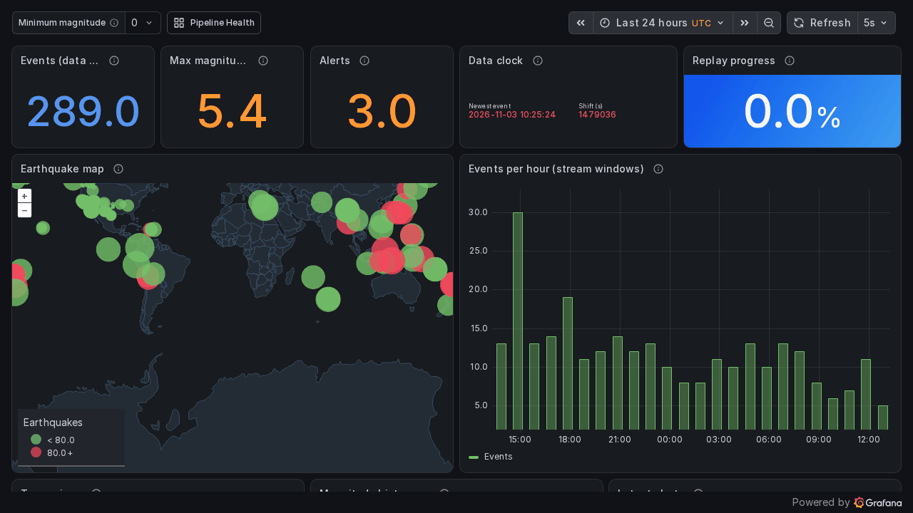
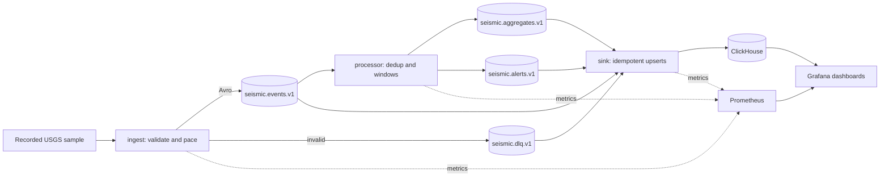
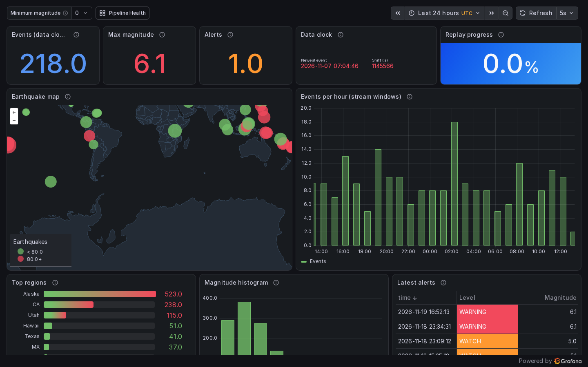
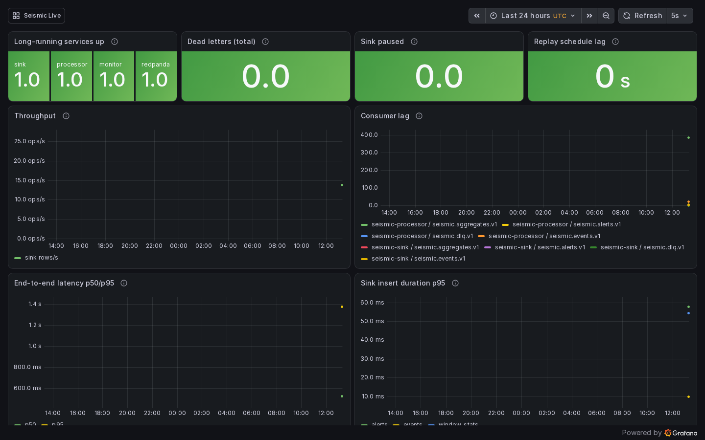

# realtime-seismic-stream

**A local real-time earthquake streaming pipeline** — Redpanda, Quix Streams, ClickHouse and
Grafana, with an offline time-compressed replay of a real USGS week. One `./install.sh` builds the
whole stack, replays ~1,800 earthquakes and opens live dashboards on your machine.

[](https://github.com/Eduardo12Pacheco/realtime-seismic-stream/actions/workflows/ci.yml)
[](LICENSE)
[](pyproject.toml)
[](compose.yaml)



## What it does

- **Schema-first streaming:** four versioned Avro contracts in Redpanda's Schema Registry, with
  `BACKWARD` compatibility checked by contract tests and `auto.register.schemas=false` at runtime.
- **Stateful processing:** exact-duplicate drops, event revisions, 60-minute event-time tumbling
  windows per region and a severity alert branch, implemented with Quix Streams.
- **Idempotent columnar sink:** ClickHouse `ReplacingMergeTree` upserts plus insert-deduplication
  tokens, DLQ isolation of poison rows by batch bisection, and pause/resume on outages.
- **Observability:** Prometheus metrics, `/healthz` and `/readyz` on every service, a lag monitor
  and two provisioned Grafana dashboards whose panels follow the stored data clock.
- **Offline by construction:** the default replay needs no internet; live USGS polling is an
  optional flag. Tests run against the real Compose stack.

## Architecture



Full component, port and data-flow details are in [docs/ARCHITECTURE.md](docs/ARCHITECTURE.md).

## Quickstart

### Linux and macOS

```sh
git clone https://github.com/Eduardo12Pacheco/realtime-seismic-stream.git
cd realtime-seismic-stream
./install.sh
```

Open <http://localhost:13000>. The default replay compresses one week of event time into ~7 minutes.

### Windows (PowerShell 7+, Docker Desktop with Linux containers)

```powershell
git clone https://github.com/Eduardo12Pacheco/realtime-seismic-stream.git
cd realtime-seismic-stream
./install.ps1
```

Open <http://localhost:13000>. Prerequisites: Docker Desktop with the WSL2 backend and ≥4 GiB free RAM.

## Demo scenarios

```sh
./install.sh --replay --speed 3600    # faster replay for screenshots (~3 min)
./install.sh --replay --chaos         # malformed records, duplicates and revisions -> DLQ
docker compose stop clickhouse        # watch the sink pause and recover, no event lost
./install.sh --down                   # stop the stack, keep volumes
```






## Results

Measured on this machine with `make bench` (three clean runs, median; see
[docs/BENCHMARKS.md](docs/BENCHMARKS.md) for the full report and exact commands).

| Metric | Value |
| --- | --- |
| Stored earthquakes | 1739 |
| Wall time | 6.7 s |
| Throughput | 259.7 events/s |
| End-to-end latency | p50 230.4 ms / p95 487.5 ms |
| Machine | Intel i5-12400T, 31.1 GiB RAM |
| Measured on | 2026-11-20 |

These numbers describe one laptop and are not a service-level objective; reproduce them with
`make bench`.

## Stack

| Component | Pinned version |
| --- | --- |
| Redpanda (Kafka API + Schema Registry) | `v26.2.7` |
| Quix Streams | `3.28.1` |
| ClickHouse | `26.8` (LTS line) |
| Grafana + ClickHouse plugin | `13.3.1` + `4.23.5` |
| Prometheus | `v3.16.0` |
| Python | `3.12` |
| Docker Compose | `>= 2.20` |

## Live mode (optional)

```sh
SEISMIC_INGEST_SOURCE=usgs docker compose -f compose.yaml -f compose.live.yaml up -d
```

Polls the USGS summary feed at most every 60 seconds, sends `If-Modified-Since`, identifies itself
in the `User-Agent`, backs off on rate limits and only emits unseen `(id, updated)` revisions.

## Documentation

- [Architecture and patterns](docs/ARCHITECTURE.md)
- [Data sources, licence and lineage](docs/DATA.md)
- [Operations, settings and troubleshooting](docs/OPERATIONS.md)
- [Benchmarks](docs/BENCHMARKS.md)
- [Architecture decision records](docs/adr/0001-redpanda.md)
- [Contributing](CONTRIBUTING.md) · [Security](SECURITY.md) · [Changelog](CHANGELOG.md)

## Limitations

- Single Redpanda node, one partition per topic, no replication, authentication or TLS.
- Windows and macOS need Docker Desktop; the stack is not natively installable there.
- Event-time windows are provisional: late revisions are not re-counted in already emitted aggregates.
- Processor dedup state is unbounded; the design targets a one-week replay, not a 24/7 feed.
- "Ecuador region" is an inclusive bounding box (including Galápagos), not a tectonic boundary.
- IGEPN was evaluated but not integrated: its only machine-readable endpoint is undocumented,
  stale and has no stated terms.
- Energy is the Gutenberg-Richter approximation; this is a data-engineering demo, not seismology.
- No Kafka transactions or end-to-end exactly-once; the sink is effectively-once via idempotency.
- Re-recording the USGS sample later may produce a different file and checksum.

## Credits and license

Bundled earthquake data: **Credit: U.S. Geological Survey** (U.S. Public Domain; see
[docs/DATA.md](docs/DATA.md)). Code released under the [MIT License](LICENSE), © 2026 Eduardo Pacheco.
