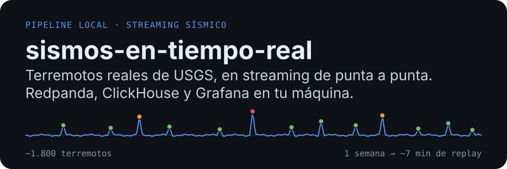
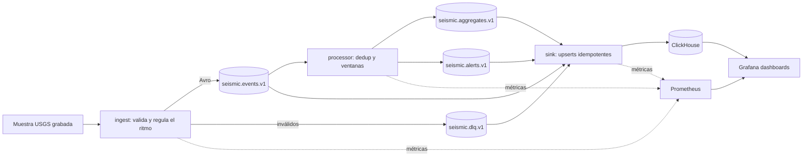
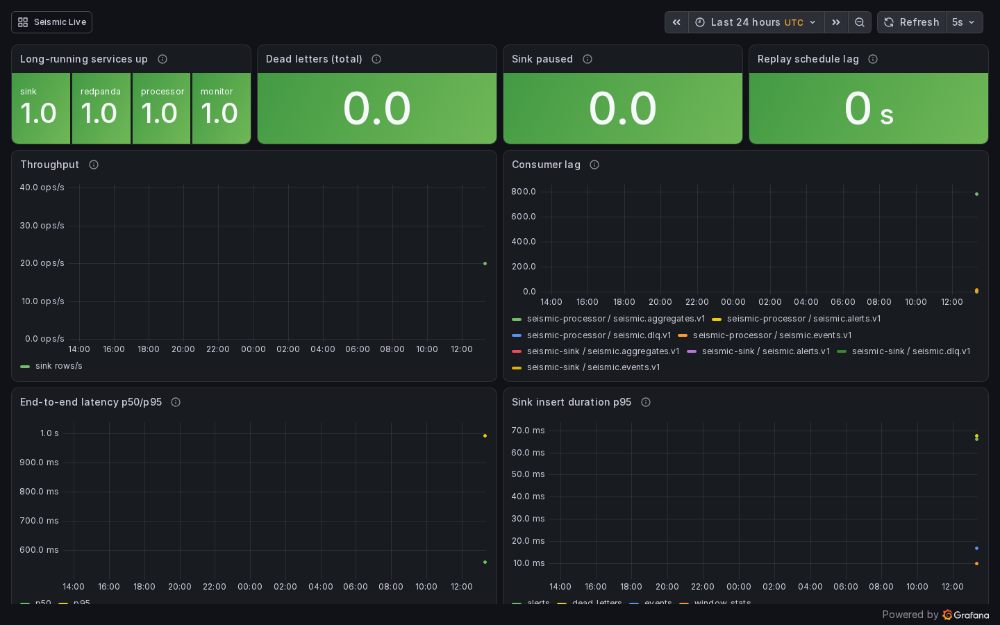
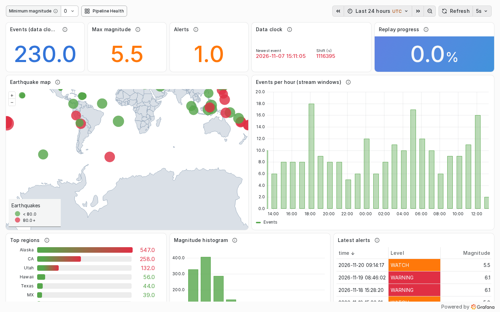

# sismos-en-tiempo-real
**Español** · [English](README.en.md)

<p align="center">
  
</p>

<p align="center">
  <strong>Pipeline local de streaming sísmico.</strong> Un solo <code>./install.sh</code> levanta el stack completo, reproduce ~1.800 terremotos reales del USGS (Servicio Geológico de EE. UU.) y abre los dashboards en vivo en tu máquina.
</p>

<p align="center">

[](https://github.com/Eduardo12Pacheco/sismos-en-tiempo-real/actions/workflows/ci.yml) [](LICENSE) [](pyproject.toml) [](compose.yaml)

</p>


## Qué es

Demo de ingeniería de datos: una semana de datos de USGS se publica como eventos Avro en Redpanda, Quix Streams la procesa y ClickHouse la guarda para verla en Grafana.

**Estado:** proyecto de portafolio en desarrollo activo; versión 0.1.0 (ver [CHANGELOG](CHANGELOG.md)).

## Por qué es distinto

- **Contratos primero:** cuatro contratos Avro versionados en el Schema Registry de Redpanda, compatibilidad `BACKWARD` verificada por tests y `auto.register.schemas=false` en runtime.
- **Procesamiento con estado:** descarte de duplicados exactos, revisiones de eventos, ventanas tumbling de 60 minutos por región en tiempo de evento y una rama de alertas con Quix Streams.
- **Sink columnar idempotente:** upserts en ClickHouse `ReplacingMergeTree` con tokens de deduplicación, aislamiento de filas venenosas en la DLQ por bisección y pausa/reanudación ante caídas.
- **Observabilidad:** métricas Prometheus, `/healthz` y `/readyz` en cada servicio, monitor de lag y dos dashboards de Grafana provisionados cuyos paneles siguen el reloj de los datos almacenados.
- **Offline por construcción:** el replay por defecto no necesita internet después de descargar las imágenes, ni GPU, API key o cuenta en la nube; el polling en vivo de USGS es opcional. Las pruebas de integración corren contra el stack real de Compose.

## Cómo funciona



Los detalles de componentes, puertos y flujo de datos están en [docs/ARCHITECTURE.md](docs/ARCHITECTURE.md). **Versiones fijadas:** Redpanda `v26.2.7` · Quix Streams `3.28.1` · ClickHouse `26.8` (línea LTS) · Grafana `13.3.1` + plugin ClickHouse `4.23.5` · Prometheus `v3.16.0` · Python `3.12` · Docker Compose `>= 2.20`.

### Modo en vivo (opcional)

```sh
SEISMIC_INGEST_SOURCE=usgs docker compose -f compose.yaml -f compose.live.yaml up -d
```

Consulta el feed resumen de USGS como máximo cada 60 segundos, envía `If-Modified-Since`, se identifica en el `User-Agent`, retrocede ante límites de tasa y solo emite revisiones `(id, updated)` no vistas.

## Inicio rápido

### Linux y macOS

```sh
git clone https://github.com/Eduardo12Pacheco/sismos-en-tiempo-real.git
cd sismos-en-tiempo-real
./install.sh
```

Abre <http://localhost:13000>. El replay por defecto comprime una semana de tiempo de evento en ~7 minutos.

### Windows (PowerShell 7+, Docker Desktop con contenedores Linux)

```powershell
git clone https://github.com/Eduardo12Pacheco/sismos-en-tiempo-real.git
cd sismos-en-tiempo-real
./install.ps1
```

Abre <http://localhost:13000>. Requisitos: Docker Desktop con backend WSL2 y ≥4 GiB de RAM.

### Escenarios de demostración

```sh
./install.sh --replay --speed 3600    # replay más rápido para capturas (~3 min)
./install.sh --replay --chaos         # registros malformados, duplicados y revisiones -> DLQ
docker compose stop clickhouse        # el sink se pausa y recupera sin perder eventos
./install.sh --down                   # detiene el stack y conserva los volúmenes
```

## Resultados

Medidos en esta máquina con `make bench` (tres corridas limpias, mediana; el informe completo y los comandos exactos están en [docs/BENCHMARKS.md](docs/BENCHMARKS.md)).

| Métrica | Valor |
| --- | --- |
| Terremotos almacenados | 1739 |
| Tiempo total (wall time) | 6.7 s |
| Throughput | 259.7 events/s |
| Latencia extremo a extremo | p50 230.4 ms / p95 487.5 ms |
| Máquina | Intel i5-12400T, 31.1 GiB RAM |
| Medido el | 2026-11-20 |

Estos números describen un portátil y no son un objetivo de nivel de servicio; repítelos con `make bench`.






## Limitaciones

- Un solo nodo de Redpanda, una partición por topic, sin replicación, autenticación ni TLS.
- Windows y macOS necesitan Docker Desktop; el stack no se instala de forma nativa allí.
- Las ventanas de tiempo de evento son provisionales: las revisiones tardías no se recuentan en agregados ya emitidos.
- El estado de deduplicación del processor no tiene cota; el diseño apunta a un replay de una semana, no a un feed 24/7.
- La "región de Ecuador" es una caja delimitadora inclusiva (con Galápagos), no un límite tectónico.
- IGEPN fue evaluado pero no integrado: su único endpoint legible por máquina no está documentado, está desactualizado y no tiene términos declarados.
- La energía usa la aproximación de Gutenberg-Richter; esto es una demo de ingeniería de datos, no sismología.
- Sin transacciones de Kafka ni exactly-once extremo a extremo; el sink es effectively-once por idempotencia.
- Volver a grabar la muestra de USGS más adelante puede producir un archivo y checksum distintos.

## Documentación

[Arquitectura y patrones](docs/ARCHITECTURE.md) · [Datos, licencia y linaje](docs/DATA.md) · [Operación y diagnóstico](docs/OPERATIONS.md) · [Benchmarks](docs/BENCHMARKS.md) · [Registros de decisiones](docs/adr/0001-redpanda.md) · [Contribuir](CONTRIBUTING.md) · [Seguridad](SECURITY.md) · [Changelog](CHANGELOG.md)

## Licencia

Código bajo la [licencia MIT](LICENSE), © 2026 Eduardo Pacheco. Datos sísmicos incluidos: **Credit: U.S. Geological Survey** (dominio público de EE. UU.; ver [docs/DATA.md](docs/DATA.md)).

## Autor

Eduardo Pacheco · https://github.com/Eduardo12Pacheco
