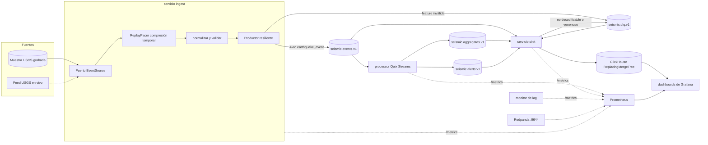
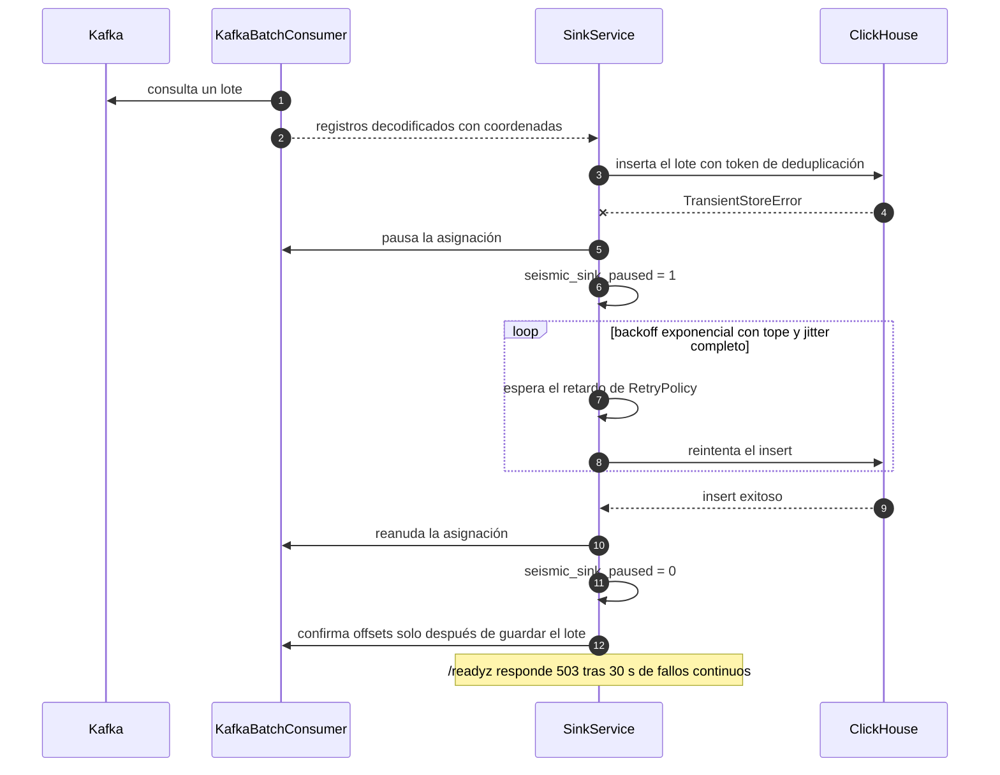

# Arquitectura

`realtime-seismic-stream` es un pipeline de streaming de tipo local-first construido como una aplicación hexagonal: un dominio sísmico puro, casos de uso de aplicación que dependen solo de puertos, y adaptadores que conectan esos puertos con Kafka, ClickHouse, Grafana, los feeds de USGS y el sistema operativo. Este documento describe las capas, los patrones usados a propósito, la topología de ejecución, los contratos de datos, la semántica de entrega, el reloj de datos y la ruta de escalado.

## Capas y regla de dependencia

| Capa | Paquete | Puede importar | Responsabilidad |
|---|---|---|---|
| Dominio | [`src/seismic_stream/domain`](../src/seismic_stream/domain/__init__.py) | solo la biblioteca estándar | `Event`, `Alert`, `WindowStats`, `DeadLetter`, validación, geografía, energía, alertas, versionado |
| Aplicación | [`src/seismic_stream/application`](../src/seismic_stream/application/__init__.py) | dominio, biblioteca estándar | casos de uso y puertos: ingesta, control de ritmo (pacing), procesamiento, envío al sink, monitoreo, reintentos |
| Adaptadores | [`src/seismic_stream/adapters`](../src/seismic_stream/adapters/__init__.py) | dominio, aplicación, clientes de terceros | Kafka, Schema Registry, ClickHouse, Quix Streams, USGS, replay, caos, observabilidad |
| Composición | [`composition.py`](../src/seismic_stream/composition.py), [`cli.py`](../src/seismic_stream/cli.py) | todas las capas | cableado de procesos, comandos de Typer, manejo de señales, códigos de salida |

La dirección de las dependencias se verifica dos veces: con los contratos de import-linter en `pyproject.toml` y con [`tests/architecture/test_import_contracts.py`](../tests/architecture/test_import_contracts.py), que ejecuta `lint-imports` en pytest y en CI. Los paquetes de dominio y aplicación también tienen prohibido importar las bibliotecas de infraestructura (`confluent_kafka`, `quixstreams`, `clickhouse_connect`, `httpx`, `prometheus_client`, `structlog`, `fastavro`), de modo que el núcleo puro sigue siendo testeable sin Kafka, Docker ni red.

Los puertos viven en [`application/ports.py`](../src/seismic_stream/application/ports.py) como definiciones `typing.Protocol`: `Clock`, `EventSource`, `EventPublisher`, `DeadLetterPublisher`, `EventStore`, `BatchConsumer`, `LagReader` y `Metrics`. Los adaptadores los implementan; los tests los sustituyen por fakes. Ningún caso de uso construye un adaptador concreto.

## Topología de ejecución

El stack de Compose tiene una red `backend` con `internal: true`. Solo Grafana se une a la red `edge` en el stack por defecto, de modo que `ingest`, `processor`, `sink` y `monitor` no pueden alcanzar internet por construcción; el modo en vivo opcional agrega `ingest` a `edge` mediante `compose.live.yaml` ([S1](../README.md), [OPERATIONS](OPERATIONS.md)).

## Patrones usados a propósito

Esta tabla es el contrato D28: cada patrón indica dónde está implementado.

| Patrón | Dónde aparece | Módulo que lo implementa |
|---|---|---|
| Puertos y adaptadores (Ports and Adapters) | Cada caso de uso depende de protocolos, nunca de Kafka ni de ClickHouse | [`application/ports.py`](../src/seismic_stream/application/ports.py) |
| Raíz de composición (Composition Root) | El único lugar que construye adaptadores y los inyecta en los servicios | [`composition.py`](../src/seismic_stream/composition.py) |
| Estrategia (Strategy) | Selección de fuente (`ReplaySource`, `UsgsLiveSource`) y tiempos de reintento | [`ports.py`](../src/seismic_stream/application/ports.py), [`retry.py`](../src/seismic_stream/application/retry.py) |
| Decorador (Decorator) | `ChaoticSource` envuelve cualquier `EventSource` sin modificarlo | [`adapters/sources/chaos.py`](../src/seismic_stream/adapters/sources/chaos.py) |
| Pipeline | Del registro de la fuente a la validación, al evento Avro y a las etapas de ventana y sink | [`application/ingest.py`](../src/seismic_stream/application/ingest.py), [`application/sinking.py`](../src/seismic_stream/application/sinking.py) |
| Canal de dead letters (Dead Letter Channel) | Features inválidas, bytes no decodificables y filas rechazadas van a un único topic DLQ | [`application/ingest.py`](../src/seismic_stream/application/ingest.py), [`application/sinking.py`](../src/seismic_stream/application/sinking.py) |
| Receptor idempotente (Idempotent Receiver) | Descarte de duplicados exactos, upserts versionados y tokens de deduplicación de inserts | [`application/processing.py`](../src/seismic_stream/application/processing.py), [`domain/versioning.py`](../src/seismic_stream/domain/versioning.py), [`adapters/storage/clickhouse.py`](../src/seismic_stream/adapters/storage/clickhouse.py) |
| Bisección (Bisection) | Una fila venenosa se aísla partiendo el lote hasta que quedan filas individuales | [`bisect_write`](../src/seismic_stream/application/sinking.py) |
| Repositorio (Repository) | `EventStore` oculta al caso de uso la estructura de las tablas y los tokens de escritura | [`application/ports.py`](../src/seismic_stream/application/ports.py), [`adapters/storage/clickhouse.py`](../src/seismic_stream/adapters/storage/clickhouse.py) |
| Capa anticorrupción (Anti-corruption layer) | Las features GeoJSON de USGS se convierten en valores `Event` inmutables del dominio | [`domain/normalize.py`](../src/seismic_stream/domain/normalize.py) |
| Pausa/reanudación al estilo circuit breaker (pause/resume) | Los fallos transitorios del store pausan la asignación, reintentan con jitter y reanudan | [`application/sinking.py`](../src/seismic_stream/application/sinking.py), [`adapters/kafka/consumer.py`](../src/seismic_stream/adapters/kafka/consumer.py) |

El procesador es una excepción deliberada al código de pipeline escrito a mano: Quix Streams es dueño de su estado y de su topología tipo SQL, mientras que la semántica de deduplicación y de ventanas permanece en helpers de aplicación para poder testearla unitariamente sin un broker ([ADR 0002](adr/0002-quix-streams.md)).

## Backpressure y recuperación ante caídas

Una falla permanente del store sigue la otra rama en `SinkService`: el lote se bisecta hasta que las filas rechazadas son registros individuales, esas filas se publican en `seismic.dlq.v1` con la etapa `sink_persist`, y las filas sanas se guardan. Los offsets se confirman solo después de que el productor de DLQ hace flush. Esta es la decisión de la [ADR 0006](adr/0006-dead-letter-channel-and-backpressure.md); el argumento de effectively-once está en la [ADR 0005](adr/0005-delivery-semantics-effectively-once.md).

## Topics y esquemas

Los cuatro topics tienen una partición y factor de replicación 1 (D5). Las claves importan: `seismic.events.v1` usa `event_id` como clave, los agregados usan `<region>|<window_start_ms>`, las alertas `event_id` y las dead letters `dlq_id`.

| Topic | Clave | Valor Avro | Retención | Productores | Consumidores |
|---|---|---|---|---|---|
| `seismic.events.v1` | `event_id` | `earthquake_event` v1 | 7 días | ingest | processor, sink |
| `seismic.aggregates.v1` | `<region>\|<window_start_ms>` | `window_stats` v1 | 7 días | processor | sink |
| `seismic.alerts.v1` | `event_id` | `alert` v1 | 30 días | processor | sink |
| `seismic.dlq.v1` | `dlq_id` | `dead_letter` v1 | 30 días | ingest, sink | sink |

Los esquemas viven en [`adapters/kafka/schemas`](../src/seismic_stream/adapters/kafka/schemas/earthquake_event.v1.avsc) y `seismic-stream bootstrap` los registra bajo `<topic>-value` con compatibilidad `BACKWARD`. Los servicios configuran `auto.register.schemas=false`, así que ningún servicio evoluciona un contrato en silencio; el único que escribe esquemas es el comando bootstrap ([ADR 0003](adr/0003-avro-schema-registry.md)).

| Esquema | Campos |
|---|---|
| `earthquake_event` | `event_id`, `source`, `event_type`, `event_time_ms`, `updated_at_ms`, `magnitude`, `magnitude_type`, `place`, `region`, `latitude`, `longitude`, `depth_km`, `status`, `tsunami`, `significance`, `network`, `detail_url`, `in_ecuador_region` |
| `window_stats` | `region`, `window_start_ms`, `window_end_ms`, `event_count`, `max_magnitude`, `mean_magnitude`, `mean_depth_km`, `total_energy_joules`, `emitted_at_ms` |
| `alert` | `event_id`, `level`, `reason`, `magnitude`, `place`, `event_time_ms`, `updated_at_ms`, `tsunami`, `in_ecuador_region` |
| `dead_letter` | `dlq_id`, `stage`, `error_type`, `error_message`, `source_topic`, `source_partition`, `source_offset`, `payload`, `failed_at_ms`, `attempts` |

Los timestamps son `long` simples de Avro en milisegundos, con nombres `*_ms`; no se usan logical types, así que los decodificadores devuelven enteros en lugar de objetos datetime (D4).

## Semántica de entrega

Cada salto es al menos una vez. El pipeline es effectively-once porque cada receptor es idempotente:

- el procesador descarta duplicados exactos de `(event_id, updated_at_ms)` y trata un `updated_at_ms` estrictamente más nuevo como una revisión ([`Deduplicator`](../src/seismic_stream/application/processing.py));
- las tablas de ClickHouse son `ReplacingMergeTree` con clave de identidad y versión, y se leen mediante vistas `*_latest` que usan `FINAL`;
- cada insert lleva un `insert_deduplication_token` construido a partir de las coordenadas de Kafka, y las tablas configuran `non_replicated_deduplication_window`;
- las dead letters llevan un `dlq_id = sha256(stage|payload)[:32]` determinístico, así que un fallo reentregado colapsa en una sola fila;
- los offsets se confirman solo después de que el almacenamiento y el flush de la DLQ tienen éxito.

Las tablas raw pueden tener transitoriamente más filas que las vistas `*_latest`; esa diferencia se mide y se informa con `verify` en lugar de ocultarse. Las transacciones de Kafka y el exactly-once extremo a extremo son objetivos explícitamente fuera de alcance (D8).

## Reloj de datos

El replay emite eventos fechados en el pasado, pero los dashboards deben verse en vivo. La vista `data_clock` de ClickHouse calcula `shift_seconds = now - max(event_time)` sobre los eventos almacenados, y cada panel sísmico grafica `event_time + shift`; el panel estadístico "Data clock" muestra el tiempo real del evento más reciente y el desplazamiento. En modo en vivo el desplazamiento es aproximadamente cero. Así el rango de tiempo de Grafana queda en el `now` real mientras los datos se ven actuales. La justificación completa y el alcance sin bucles están en la [ADR 0007](adr/0007-replay-event-time-and-data-clock.md); el generador de paneles es [`scripts/build_dashboards.py`](../scripts/build_dashboards.py).

## Configuración y observabilidad

Todos los parámetros de ejecución son un único modelo `Settings` tipado en [`config.py`](../src/seismic_stream/config.py), con prefijo `SEISMIC_`, validado al arrancar y documentado en [OPERATIONS.md](OPERATIONS.md#configuración) y en `.env.example`. Los valores inválidos salen con código 2 y nombran la variable que falla. Los logs son JSON de structlog en stdout con los campos `ts`, `level`, `service`, `event` y `logger`. Cada servicio de larga duración expone `/metrics`, `/healthz` y `/readyz`; el catálogo es [`METRIC_CATALOG`](../src/seismic_stream/adapters/observability/metrics.py) y tiene pruebas de deriva contra la documentación de operación.

## Notas de escalado

El diseño ejecuta intencionalmente una partición por topic: la semana grabada es pequeña, las ventanas de tiempo de evento deben ser reproducibles y una sola partición preserva el orden. La ruta de escalado, si el proyecto alguna vez la necesitara, es:

1. aumentar el número de particiones y usar `event_id` como clave (ya es la clave), lo que preserva el orden por evento pero ya no da un orden global por tiempo de evento;
2. hacer que las ventanas toleren particiones fuera de orden apoyándose en el tiempo de evento y en la gracia, en lugar del orden de llegada, y aumentar el tamaño de lote del sink;
3. reemplazar el estado de deduplicación en proceso por un store acotado en el tiempo, ya que el estado RocksDB de Quix crece con los ids distintos;
4. agregar réplicas para Redpanda y ClickHouse y activar la ventana de deduplicación replicada; la lógica de pausa/reanudación y de bisección del sink ya es independiente del broker.

Mientras tanto, las restricciones vigentes se listan en [README.md](../README.md): un solo nodo, sin autenticación ni TLS, ventanas provisionales ante revisiones, estado de deduplicación sin cota y sin garantía de exactly-once.

## Documentos relacionados

- [Fuentes de datos, checksum y licencia](DATA.md)
- [Operación, configuración y diagnóstico](OPERATIONS.md)
- [ADR 0001](adr/0001-redpanda.md)
