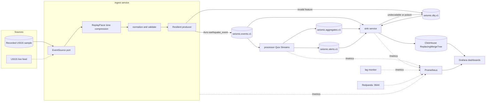

# Architecture

`realtime-seismic-stream` is a local-first streaming pipeline built as a
hexagonal application: a pure seismic domain, application use cases that depend
only on ports, and adapters that connect those ports to Kafka, ClickHouse,
Grafana, the USGS feeds and the operating system. This document describes the
layers, the patterns used on purpose, the runtime topology, the data contracts,
the delivery semantics, the data clock and the scaling path.

## Layers and the dependency rule

| Layer | Package | May import | Responsibility |
|---|---|---|---|
| Domain | [`src/seismic_stream/domain`](../src/seismic_stream/domain/__init__.py) | standard library only | `Event`, `Alert`, `WindowStats`, `DeadLetter`, validation, geography, energy, alerts, versioning |
| Application | [`src/seismic_stream/application`](../src/seismic_stream/application/__init__.py) | domain, standard library | use cases and ports: ingest, pacing, processing, sinking, monitoring, retry |
| Adapters | [`src/seismic_stream/adapters`](../src/seismic_stream/adapters/__init__.py) | domain, application, third-party clients | Kafka, Schema Registry, ClickHouse, Quix Streams, USGS, replay, chaos, observability |
| Composition | [`composition.py`](../src/seismic_stream/composition.py), [`cli.py`](../src/seismic_stream/cli.py) | every layer | process wiring, Typer commands, signal handling, exit codes |

The dependency direction is enforced twice: by the import-linter contracts in
`pyproject.toml` and by [`tests/architecture/test_import_contracts.py`](../tests/architecture/test_import_contracts.py),
which runs `lint-imports` in pytest and in CI. The domain and application
packages are also forbidden from importing the infrastructure libraries
(`confluent_kafka`, `quixstreams`, `clickhouse_connect`, `httpx`,
`prometheus_client`, `structlog`, `fastavro`), so the pure core stays testable
without Kafka, Docker or a network.

Ports live in [`application/ports.py`](../src/seismic_stream/application/ports.py)
as `typing.Protocol` definitions: `Clock`, `EventSource`, `EventPublisher`,
`DeadLetterPublisher`, `EventStore`, `BatchConsumer`, `LagReader` and `Metrics`.
Adapters implement them; tests substitute fakes. No use case constructs a
concrete adapter.

## Runtime topology

The Compose stack has an `internal: true` `backend` network. Only Grafana joins
the `edge` network in the default stack, so `ingest`, `processor`, `sink` and
`monitor` cannot reach the internet by construction; the optional live mode adds
`ingest` to `edge` through `compose.live.yaml` ([S1](../README.md), [OPERATIONS](OPERATIONS.md)).

## Patterns used deliberately

This table is the D28 contract: each pattern names where it is implemented.

| Pattern | Where it appears | Implementing module |
|---|---|---|
| Ports and Adapters | Every use case depends on protocols, never on Kafka or ClickHouse | [`application/ports.py`](../src/seismic_stream/application/ports.py) |
| Composition Root | The only place that builds adapters and injects them into services | [`composition.py`](../src/seismic_stream/composition.py) |
| Strategy | Source selection (`ReplaySource`, `UsgsLiveSource`) and retry timing | [`ports.py`](../src/seismic_stream/application/ports.py), [`retry.py`](../src/seismic_stream/application/retry.py) |
| Decorator | `ChaoticSource` wraps any `EventSource` without changing it | [`adapters/sources/chaos.py`](../src/seismic_stream/adapters/sources/chaos.py) |
| Pipeline | Source record to validation to Avro event to window and sink stages | [`application/ingest.py`](../src/seismic_stream/application/ingest.py), [`application/sinking.py`](../src/seismic_stream/application/sinking.py) |
| Dead Letter Channel | Invalid features, undecodable bytes and rejected rows go to one DLQ topic | [`application/ingest.py`](../src/seismic_stream/application/ingest.py), [`application/sinking.py`](../src/seismic_stream/application/sinking.py) |
| Idempotent Receiver | Exact-duplicate drop, versioned upserts and insert dedup tokens | [`application/processing.py`](../src/seismic_stream/application/processing.py), [`domain/versioning.py`](../src/seismic_stream/domain/versioning.py), [`adapters/storage/clickhouse.py`](../src/seismic_stream/adapters/storage/clickhouse.py) |
| Bisection | A poison row is isolated by splitting the batch until single rows remain | [`bisect_write`](../src/seismic_stream/application/sinking.py) |
| Repository | `EventStore` hides table layout and write tokens from the use case | [`application/ports.py`](../src/seismic_stream/application/ports.py), [`adapters/storage/clickhouse.py`](../src/seismic_stream/adapters/storage/clickhouse.py) |
| Anti-corruption layer | USGS GeoJSON features become immutable domain `Event` values | [`domain/normalize.py`](../src/seismic_stream/domain/normalize.py) |
| Circuit-style pause/resume | Transient store failures pause the assignment, retry with jitter and resume | [`application/sinking.py`](../src/seismic_stream/application/sinking.py), [`adapters/kafka/consumer.py`](../src/seismic_stream/adapters/kafka/consumer.py) |

The processor itself is a deliberate exception to hand-written pipeline code:
Quix Streams owns its state and SQL-like topology, while the dedup and window
semantics stay in application helpers so they can be unit tested without a
broker ([ADR 0002](adr/0002-quix-streams.md)).

## Backpressure and outage recovery

```mermaid
sequenceDiagram
  autonumber
  participant K as Kafka
  participant C as KafkaBatchConsumer
  participant S as SinkService
  participant CH as ClickHouse
  C->>K: poll batch
  C-->>S: decoded records with coordinates
  S->>CH: insert batch with dedup token
  CH--xS: TransientStoreError
  S->>C: pause assignment
  S->>S: seismic_sink_paused = 1
  loop capped exponential backoff with full jitter
    S->>S: wait RetryPolicy delay
    S->>CH: retry insert
  end
  CH-->>S: insert succeeded
  S->>C: resume assignment
  S->>S: seismic_sink_paused = 0
  S->>C: commit offsets only after the batch is stored
  Note over S: /readyz turns 503 after 30 s of continuous failure
```

A permanent store error follows the other branch in `SinkService`: the batch is
bisected until the rejected rows are single records, those rows are published to
`seismic.dlq.v1` with stage `sink_persist`, and the healthy rows are stored.
Offsets are committed only after the DLQ producer flushes. This is the
[ADR 0006](adr/0006-dead-letter-channel-and-backpressure.md) decision; the
effectively-once argument is in [ADR 0005](adr/0005-delivery-semantics-effectively-once.md).

## Topics and schemas

All four topics have one partition and replication factor 1 (D5). Keys matter:
`seismic.events.v1` is keyed by `event_id`, aggregates by
`<region>|<window_start_ms>`, alerts by `event_id` and dead letters by `dlq_id`.

| Topic | Key | Avro value | Retention | Producers | Consumers |
|---|---|---|---|---|---|
| `seismic.events.v1` | `event_id` | `earthquake_event` v1 | 7 days | ingest | processor, sink |
| `seismic.aggregates.v1` | `<region>\|<window_start_ms>` | `window_stats` v1 | 7 days | processor | sink |
| `seismic.alerts.v1` | `event_id` | `alert` v1 | 30 days | processor | sink |
| `seismic.dlq.v1` | `dlq_id` | `dead_letter` v1 | 30 days | ingest, sink | sink |

Schemas live under [`adapters/kafka/schemas`](../src/seismic_stream/adapters/kafka/schemas/earthquake_event.v1.avsc)
and are registered by `seismic-stream bootstrap` under `<topic>-value` with
`BACKWARD` compatibility. Services set `auto.register.schemas=false`, so a
service never evolves a contract silently; the only writer of schemas is the
bootstrap command ([ADR 0003](adr/0003-avro-schema-registry.md)).

| Schema | Fields |
|---|---|
| `earthquake_event` | `event_id`, `source`, `event_type`, `event_time_ms`, `updated_at_ms`, `magnitude`, `magnitude_type`, `place`, `region`, `latitude`, `longitude`, `depth_km`, `status`, `tsunami`, `significance`, `network`, `detail_url`, `in_ecuador_region` |
| `window_stats` | `region`, `window_start_ms`, `window_end_ms`, `event_count`, `max_magnitude`, `mean_magnitude`, `mean_depth_km`, `total_energy_joules`, `emitted_at_ms` |
| `alert` | `event_id`, `level`, `reason`, `magnitude`, `place`, `event_time_ms`, `updated_at_ms`, `tsunami`, `in_ecuador_region` |
| `dead_letter` | `dlq_id`, `stage`, `error_type`, `error_message`, `source_topic`, `source_partition`, `source_offset`, `payload`, `failed_at_ms`, `attempts` |

Timestamps are plain Avro `long` milliseconds named `*_ms`; no logical types are
used, so decoders return integers instead of datetime objects (D4).

## Delivery semantics

Every hop is at least once. The pipeline is effectively once because each
receiver is idempotent:

- the processor drops exact `(event_id, updated_at_ms)` duplicates and treats a
  strictly newer `updated_at_ms` as a revision ([`Deduplicator`](../src/seismic_stream/application/processing.py));
- ClickHouse tables are `ReplacingMergeTree` keyed by identity and version, read
  through `*_latest` views using `FINAL`;
- every insert carries `insert_deduplication_token` built from the Kafka
  coordinates, and tables set `non_replicated_deduplication_window`;
- dead letters carry a deterministic `dlq_id = sha256(stage|payload)[:32]`, so a
  redelivered failure collapses to one row;
- offsets are committed only after storage and DLQ flushing succeed.

Raw tables can transiently hold more rows than the `*_latest` views; that
difference is measured and reported by `verify` rather than hidden. Kafka
transactions and end-to-end exactly-once are explicit non-goals (D8).

## Data clock

The replay emits events dated in the past, but the dashboards must look live.
The ClickHouse `data_clock` view computes `shift_seconds = now - max(event_time)`
over stored events, and every seismic panel plots `event_time + shift`; the
"Data clock" stat panel shows the real newest event time and the shift. In live
mode the shift is approximately zero. This keeps Grafana's time range at the
real `now` while the data looks current. The full rationale and the no-loop
scope are in [ADR 0007](adr/0007-replay-event-time-and-data-clock.md); the panel
generator is [`scripts/build_dashboards.py`](../scripts/build_dashboards.py).

## Configuration and observability

All runtime knobs are one typed `Settings` model in
[`config.py`](../src/seismic_stream/config.py), prefixed `SEISMIC_`, validated at
startup and documented in [OPERATIONS.md](OPERATIONS.md#configuration) and
`.env.example`. Invalid values exit with code 2 and name the offending variable.
Logs are structlog JSON on stdout with `ts`, `level`, `service`, `event` and
`logger` fields. Every long-running service serves `/metrics`, `/healthz` and
`/readyz`; the catalog is
[`METRIC_CATALOG`](../src/seismic_stream/adapters/observability/metrics.py) and is
drift-tested against the operations documentation.

## Scaling notes

The design intentionally runs one partition per topic: the recorded week is
small, event-time windows must be reproducible, and a single partition preserves
order. The scale-out path, if the project ever needed it, is:

1. raise the partition count and key events by `event_id` (already the key), which
   preserves per-event ordering but no longer gives one global event-time order;
2. make the windows tolerate out-of-order partitions by relying on event time and
   grace rather than arrival order, and increase the sink batch size;
3. replace the in-process dedup state with a time-bounded store, since the Quix
   RocksDB state grows with distinct ids;
4. add replicas for Redpanda and ClickHouse and turn on the replicated dedup
   window; the sink's pause/resume and bisection logic is already broker-agnostic.

Until then the honest constraints are listed in [README.md](../README.md): single
node, no auth or TLS, provisional windows on revision, unbounded dedup state and
no exactly-once guarantee.

## Related documents

- [Data sources, checksum and licence](DATA.md)
- [Operations, configuration and troubleshooting](OPERATIONS.md)
- [ADR 0001](adr/0001-redpanda.md)
