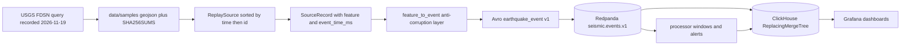

# Data sources and lineage

This document records where the data in `data/samples/` comes from, how it is
licensed, how the checksum is verified, and which sources were evaluated but
not integrated. The runtime flow that consumes this data is described in
[ARCHITECTURE.md](ARCHITECTURE.md); the commands are in
[OPERATIONS.md](OPERATIONS.md).

## Bundled sample

| Field | Value |
|---|---|
| File | `data/samples/usgs_2026-11-02_2026-11-09_m1.geojson` |
| Source | USGS FDSN Event Web Service (`https://earthquake.usgs.gov/fdsnws/event/1/query`) |
| Query | `format=geojson&starttime=2026-11-02T00:00:00&endtime=2026-11-09T00:00:00&minmagnitude=1.0&orderby=time-asc` |
| Retrieved | 2026-11-19 (UTC) |
| Format | GeoJSON `FeatureCollection`, USGS API `2.8.4` |
| sha256 | `4e2449956e130c2bfdc997bf6b9d084f20767ec7f04cf01b041b3d4263f41f3e` |
| Size | 1,300,880 bytes |
| Licence | U.S. Public Domain (see below) |
| Credit | Credit: U.S. Geological Survey |

The response is stored verbatim: the repository does not rewrite, filter or
re-serialize the sample. `data/samples/SHA256SUMS` pins the exact bytes and is
checked with:

```bash
(cd data/samples && sha256sum -c SHA256SUMS)
```

`*.geojson -text` in `.gitattributes` stops Git from converting line endings, so
a fresh checkout on Windows keeps the same checksum as Linux and macOS.

### Reproducing the download

`scripts/record_sample.py` contains the pinned URL and query parameters and
uses only the Python standard library:

```bash
python scripts/record_sample.py                       # download + write SHA256SUMS
python scripts/record_sample.py --verify              # offline checksum check
```

USGS revises events over time (magnitudes and locations are updated, events can
be added or removed), so a re-recorded file may not be byte-identical to the
committed one. A new recording is still valid: replace the file, run the script
(or `sha256sum`) to refresh `SHA256SUMS`, and update the checksum above. Tests
compute counts from the file and read the manifest instead of hard-coding the
recording date's numbers.

## Licence and credit

USGS copyright policy states: "USGS-authored or produced data and information
are considered to be in the U.S. Public Domain." Redistribution of the recorded
sample is therefore allowed. USGS asks for proper credit, so every surface that
exposes the data carries the line:

```text
Credit: U.S. Geological Survey
```

## Lineage



The domain `Event` is immutable and versioned by `updated_at_ms`: the processor
drops exact duplicates, treats a strictly newer timestamp as a revision, and the
sink keeps the newest version in the `events_latest` view. The full contract is
in [ARCHITECTURE.md](ARCHITECTURE.md#topics-and-schemas) and
[ADR 0007](adr/0007-replay-event-time-and-data-clock.md).

The optional live mode polls the documented USGS real-time GeoJSON summary
feeds; it is never used by tests or by the default offline replay.

## Evaluated but not integrated

| Source | Evidence | Why it is not used |
|---|---|---|
| IGEPN Ecuador `https://www.igepn.edu.ec/portal/eventos/www/events.xml` | HTTP 200 `text/xml`, 5,044 bytes; `last-modified: Mon, 31 Aug 2026 15:01:26 GMT` (80 days stale when checked on 2026-11-19) | Undocumented format, no FDSN/QuakeML endpoint found and no terms or licence stated. The repository only documents the evaluation; it does not redistribute IGEPN data. |

## Recorded profile (reference only)

The committed recording contains 1,817 features: 1,739 earthquakes, 36 quarry
blasts, 22 ice quakes, 19 explosions and 1 "other event". These figures are
informational; `replay-info` and the tests derive them from the file.

## Related documents

- [Architecture](ARCHITECTURE.md)
- [Operations](OPERATIONS.md)
- [ADR 0005: effectively-once delivery](adr/0005-delivery-semantics-effectively-once.md)
- [ADR 0007: replay, event time and the data clock](adr/0007-replay-event-time-and-data-clock.md)
