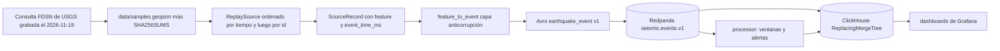

# Fuentes de datos y linaje

Este documento registra de dónde proviene el dato de `data/samples/`, cómo está licenciado, cómo se verifica el checksum y qué fuentes se evaluaron pero no se integraron. El flujo de ejecución que consume estos datos está descrito en [ARCHITECTURE.md](ARCHITECTURE.md); los comandos están en [OPERATIONS.md](OPERATIONS.md).

## Muestra incluida

| Campo | Valor |
|---|---|
| Archivo | `data/samples/usgs_2026-11-02_2026-11-09_m1.geojson` |
| Fuente | USGS FDSN Event Web Service (`https://earthquake.usgs.gov/fdsnws/event/1/query`) |
| Consulta | `format=geojson&starttime=2026-11-02T00:00:00&endtime=2026-11-09T00:00:00&minmagnitude=1.0&orderby=time-asc` |
| Descargada | 2026-11-19 (UTC) |
| Formato | `FeatureCollection` de GeoJSON, API de USGS `2.8.4` |
| sha256 | `4e2449956e130c2bfdc997bf6b9d084f20767ec7f04cf01b041b3d4263f41f3e` |
| Tamaño | 1.300.880 bytes |
| Licencia | Dominio público de EE. UU. (ver abajo) |
| Crédito | Credit: U.S. Geological Survey |

La respuesta se guarda tal cual: el repositorio no reescribe, filtra ni vuelve a serializar la muestra. `data/samples/SHA256SUMS` fija los bytes exactos y se verifica con:

```bash
(cd data/samples && sha256sum -c SHA256SUMS)
```

La regla `*.geojson -text` en `.gitattributes` evita que Git convierta los finales de línea, así que un checkout nuevo en Windows conserva el mismo checksum que en Linux y macOS.

### Reproducir la descarga

`scripts/record_sample.py` contiene la URL fijada y los parámetros de consulta, y usa solo la biblioteca estándar de Python:

```bash
python scripts/record_sample.py                       # descarga + escribe SHA256SUMS
python scripts/record_sample.py --verify              # verificación de checksum offline
```

USGS revisa los eventos con el tiempo (se actualizan magnitudes y ubicaciones, y se pueden agregar o eliminar eventos), así que un archivo regrabado puede no ser idéntico byte a byte al confirmado. Una nueva grabación sigue siendo válida: reemplaza el archivo, ejecuta el script (o `sha256sum`) para actualizar `SHA256SUMS` y actualiza el checksum de arriba. Los tests calculan los conteos a partir del archivo y leen el manifiesto en lugar de codificar los números de la fecha de grabación.

## Licencia y crédito

La política de derechos de autor de USGS establece que los datos e información producidos por USGS se consideran de dominio público de los EE. UU. ("USGS-authored or produced data and information are considered to be in the U.S. Public Domain."). Por lo tanto, se permite redistribuir la muestra grabada. USGS pide que se dé el crédito correspondiente, así que cada superficie que expone los datos incluye esta línea:

```text
Credit: U.S. Geological Survey
```

## Linaje



El `Event` del dominio es inmutable y se versiona por `updated_at_ms`: el processor descarta duplicados exactos, trata un timestamp estrictamente más nuevo como una revisión, y el sink conserva la versión más reciente en la vista `events_latest`. El contrato completo está en [ARCHITECTURE.md](ARCHITECTURE.md#topics-y-esquemas) y en la [ADR 0007](adr/0007-replay-event-time-and-data-clock.md).

El modo en vivo opcional consulta los feeds resumen GeoJSON en tiempo real documentados por USGS; nunca lo usan los tests ni el replay offline por defecto.

## Evaluadas pero no integradas

| Fuente | Evidencia | Por qué no se usa |
|---|---|---|
| IGEPN Ecuador `https://www.igepn.edu.ec/portal/eventos/www/events.xml` | HTTP 200 `text/xml`, 5.044 bytes; `last-modified: Mon, 31 Aug 2026 15:01:26 GMT` (80 días desactualizado al momento de la verificación, 2026-11-19) | Formato no documentado, no se encontró endpoint FDSN/QuakeML y no se declaran términos ni licencia. El repositorio solo documenta la evaluación; no redistribuye datos de IGEPN. |

## Perfil de la grabación (solo referencia)

La grabación confirmada contiene 1.817 features: 1.739 terremotos, 36 voladuras de cantera, 22 sismos de hielo, 19 explosiones y 1 "otro evento". Estas cifras son informativas; `replay-info` y los tests las derivan del archivo.

## Documentos relacionados

- [Arquitectura](ARCHITECTURE.md)
- [Operación](OPERATIONS.md)
- [ADR 0005: entrega effectively-once](adr/0005-delivery-semantics-effectively-once.md)
- [ADR 0007: replay, tiempo de evento y reloj de datos](adr/0007-replay-event-time-and-data-clock.md)
